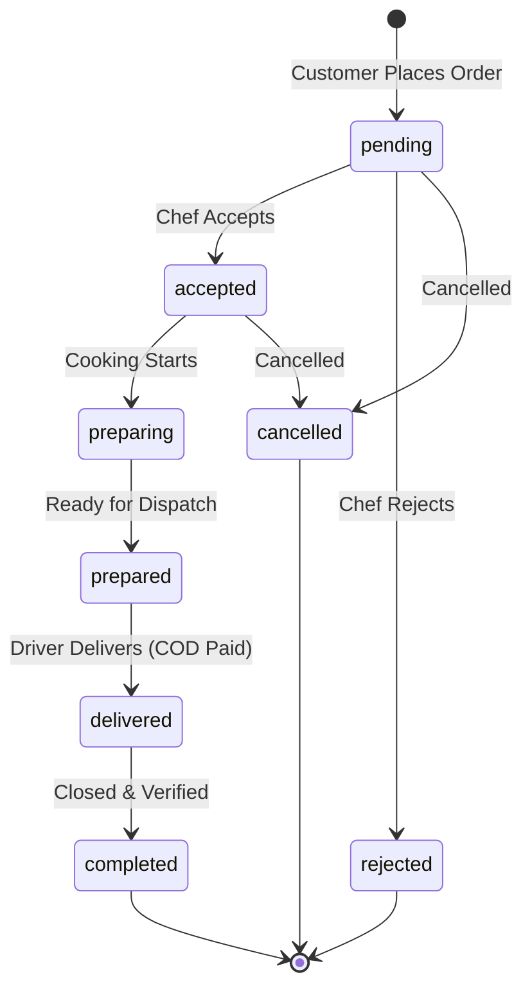

# Wajbati (وجباتي) — Home Cooked Food Delivery Platform 🍽️

Wajbati is a production-hardened multi-vendor home-food marketplace platform built with **Laravel 12 (PHP 8.2 / 8.3)**, **Bootstrap 5 (RTL/LTR)**, and **Vite**. It connects local home chefs and families with customers seeking fresh, authentic, homemade meals.

---

## 🛠️ Tech Stack & Architecture

- **Backend:** Laravel 12.x on PHP 8.2 / 8.3
- **Frontend:** Bootstrap 5.3 (native RTL & LTR builds), Font Awesome 6, Chart.js, Alpine.js, Cairo Arabic Typography
- **Asset Pipeline:** Vite (fully self-hosted, zero CDN requests)
- **Database:** MySQL 8.0+ in production, SQLite for fast zero-config local testing and CI
- **Caching & Queue:** Database/Redis driver for asynchronous notifications and stats caching
- **Testing:** Pest & PHPUnit with 116+ automated security, commerce, and feature tests

---

## 📦 Setup & Local Development

1. **Clone the repository:**
   ```bash
   git clone https://github.com/your-org/wajbati.git
   cd wajbati
   ```

2. **Install dependencies:**
   ```bash
   composer install
   npm install
   ```

3. **Configure environment:**
   ```bash
   cp .env.example .env
   php artisan key:generate
   php artisan storage:link
   ```

4. **Run migrations and seeds:**
   ```bash
   php artisan migrate --seed
   ```
   *Note: In development, `DemoSeeder` seeds sample chefs and meals. Production seeder guards against creating demo credentials.*

5. **Build assets & start servers:**
   ```bash
   npm run build
   # Run local web server and queue worker:
   php artisan serve
   php artisan queue:work
   ```

---

## ⚙️ Environment Variables Reference

| Variable | Description | Default / Recommended |
|---|---|---|
| `APP_NAME` | Application name | `Wajbati` |
| `APP_ENV` | Environment | `local` / `production` |
| `APP_DEBUG` | Debug mode | `false` in production |
| `APP_TIMEZONE` | System timezone | `Asia/Gaza` |
| `APP_LOCALE` | Default UI locale | `ar` |
| `APP_FALLBACK_LOCALE` | Fallback locale | `en` |
| `DB_CONNECTION` | Database driver | `mysql` or `sqlite` |
| `SHOP_CURRENCY_CODE` | ISO Currency code | `ILS` |
| `SHOP_CURRENCY_SYMBOL` | Currency symbol | `₪` |
| `SHOP_DELIVERY_FEE` | Delivery fee per chef | `3.00` |
| `SHOP_CARD_ENABLED` | Credit card gateway toggle | `false` (COD by default) |
| `REQUIRE_EMAIL_VERIFICATION` | Force email verification | `true` |
| `ADMIN_EMAIL` | Initial Admin Account Email | `admin@wajbati.test` |
| `ADMIN_PASSWORD` | Initial Admin Password | Secure password |

---

## 👥 Role & Permissions Matrix

| Feature / Area | Guest | Customer (`user`) | Chef (`chef`) | Admin (`admin`) |
|---|:---:|:---:|:---:|:---:|
| Browse Meals & Chefs | ✅ | ✅ | ✅ | ✅ |
| Manage Cart & Place Orders | ✅ (Session) | ✅ | ❌ (Cannot order own) | ❌ |
| Order History & Profile | ❌ | ✅ | ✅ | ✅ |
| Chef Kitchen Dashboard | ❌ | ❌ | ✅ | ❌ |
| Chef Meals & Order Management | ❌ | ❌ | ✅ (Own kitchen only) | ❌ |
| Admin Control Panel | ❌ | ❌ | ❌ | ✅ |
| User & System Moderation | ❌ | ❌ | ❌ | ✅ |

---

## 🔄 Order Status Lifecycle (State Machine)

Orders transition strictly through verified state paths:



### 💳 Payment Lifecycle
- **Cash on Delivery (Default):** Created with `payment_status: pending`. Automatically transitions to `paid` upon order delivery.
- **Card Payments:** Gated behind `SHOP_CARD_ENABLED=false` until dedicated gateway integration in Phase 5.

---

## 🚀 Production Deployment & Security Checklist

1. **Web Server Security:** Deny PHP execution in user upload directories (`/storage`):
   ```nginx
   # Nginx configuration snippet
   location ^~ /storage/ {
       location ~ \.(php|phar|phtml)$ {
           deny all;
       }
   }
   ```
2. **Environment & Caching:**
   ```bash
   php artisan config:cache
   php artisan route:cache
   php artisan view:cache
   npm run build
   ```
3. **Queue Worker:** Run a supervisor daemon for asynchronous emails and notifications:
   ```bash
   php artisan queue:work --sleep=3 --tries=3
   ```
4. **Security Headers:** The `SecurityHeaders` middleware automatically attaches:
   - `X-Frame-Options: DENY`
   - `X-Content-Type-Options: nosniff`
   - `X-XSS-Protection: 1; mode=block`
   - `Referrer-Policy: strict-origin-when-cross-origin`
   - `Strict-Transport-Security` (HTTPS only)
   - `Content-Security-Policy-Report-Only`

---

## 🧪 Testing & Verification

Run the comprehensive test suite:
```bash
php artisan test
```

Code style check:
```bash
vendor/bin/pint --test
```
